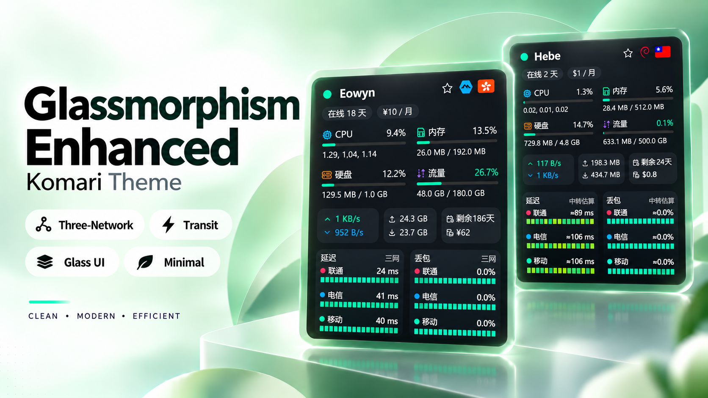

# Glassmorphism Enhanced

基于 [Komari](https://github.com/komari-monitor/komari) 的第三方监控主题。保留毛玻璃设计，重点展示节点状态、流量和中国联通／电信／移动三网延迟。

[](https://github.com/casiuna/Glassmorphism-Enhanced/releases/tag/v1.2.1)
[](LICENSE)

> **[v1.2.1 发行版本](https://github.com/casiuna/Glassmorphism-Enhanced/releases/tag/v1.2.1)**：统一顶部标签的居中、尺寸和截断；线路摘要采用**红／蓝／绿三列等宽、组内居中**，只显示圆点和完整名称，不显示运营商前缀、不省略截断；Enhanced 设置合并为五个一级分类；新增按节点 UUID 保存的**独立流量重置日**。发行附件与发布状态以该 GitHub Release 为准；[v1.2.0](https://github.com/casiuna/Glassmorphism-Enhanced/releases/tag/v1.2.0) 保留不变。
>
> **前台卡片不显示重置日、周期日期或倒计时**，不增加流量区域高度。周期详情和逐台保存仅在后台「节点与卡片 → 流量周期」。没有设置重置日或历史不足时，不用累计量冒充周期配额，也不伪造 0 GB。
>
> v1.2.0 引入的顶部自定义标签和三网回程继续保留。原生 tags、ASN/upstream 和拓扑元数据不改写；手动线路优先，自动探测默认关闭，自动详细结果仅管理员可见。浏览器不会执行 traceroute、SSH 或远程 Shell。
>
> 实测兼容目标为 Komari **1.6.0**；**1.6.1 未实测**。此前完成过单节点湖北 CDN 的六份真实 TCP/UDP 路径采集及隔离回放，但未获得 ASN 外部补全授权，均不足以确认商业线路。**v1.2.1 不宣称已完成可直接用于生产的自动回程探测或可靠线路类型识别**；实验性 Helper/Plugin 默认关闭，未完成产品实时采集到回传的真实公网闭环。部署见 [Enhanced Full](docs/full.md)，流量口径见 [独立流量周期](docs/traffic-cycles.md)，证据边界见 [CDN 回放验证](docs/cdn-replay-validation.md)。



## 主要功能

- **顶部标签与线路摘要**：顶部多标签居中、长标签悬停可查看全文；线路固定三等分并将圆点和完整名称组内居中，不缩写、不省略。未知、过期、失败、模拟和协议冲突不显示为有效线路，私有证据留在管理员详情。
- **三网监控**：分别显示联通、电信、移动的延迟、丢包率和历史记录，支持多个 Ping 任务。
- **中转延迟**：可选 Transit Carrier Ping，使用 Relay 两段探测数据估算目标节点的三网质量。
- **独立流量周期**：每节点手动设置每月 1–31 日，上海午夜切换统计区间，短月份取月末、后续月份恢复原设定日期；保留原累计数据、历史图表和限额模式。
- **节点与界面**：多尺寸卡片、列表、节点详情、响应式布局、浅色／深色主题及可选地球可视化。
- **辅助工具**：节点对比、健康摘要、财务估算和 CSV／JSON 导出。
- **财务与汇率**：支持 SGD（新加坡元）等 13 种币种的费用估算与换算，支持在线汇率、缓存及手动调整。

## 安装

1. 从 [v1.2.1 正式 Release](https://github.com/casiuna/Glassmorphism-Enhanced/releases/tag/v1.2.1) 下载**原生主题 ZIP**（`komari-theme-Glassmorphism-build-*.zip`）。Full `.tar.gz` 是完整安装/回滚包，不能直接上传到主题管理器；不要下载 GitHub 自动生成的 Source code ZIP，也不要将预提交 dirty 验收包部署到生产。旧版 [v1.2.0](https://github.com/casiuna/Glassmorphism-Enhanced/releases/tag/v1.2.0) 继续保留。
2. 在 Komari 后台上传、启用。主题标识保持 `Enhanced`，v1.2.0 / v1.1.1 的既有托管设置沿同一 short 保留。
3. 管理员登录后，点击页头「Enhanced 管理 → 03 · 线路与延迟」，选择节点并填写联通／电信／移动三个名称；手动线路**无需 Plugin、Helper 或远控**。开关、TTL、三网 Ping 和 Transit 同属03；原JSON和可选采集诊断默认折叠，使用同一托管配置。主题自带兼容后台可桥接管理页，服务器内置 `/admin/theme_managed` 仍是原生编辑器，不由主题接管。依赖审计见 [后台与伴生组件说明](docs/settings-companion-audit.md)。
4. 如需周期配额，在「节点与卡片 → 流量周期」为每台节点选择重置日并逐台保存，无需填写 JSON 或修改 Agent。

五个一级分类为：**基础与首页、节点与卡片、线路与延迟、外观与背景、高级设置**。分类调整不删除原字段、默认值、未知设置或其他节点配置。

原生主题 ZIP 即可使用手动线路、标签和流量周期。Helper/Plugin 的实验性采集链路另需明确授权、同构建组件和本地安全配置，不能在浏览器内执行；本版本不把它列为已验收的生产自动探测功能。不会自动部署至生产 Komari，也不修改 Komari Server / Agent 代码。

## 三网与中转

三网直连探测使用已有 Komari Ping 任务，支持中文运营商名称及常见英文别名。在「线路与延迟」中启用 Transit Carrier Ping，并按行填写：

```text
# 中转节点|目标节点|链路任务名
RelayNode|TargetNode|Relay-Target
```

Relay 需要三网探测任务和探测目标节点的链路任务。**字段顺序固定为「中转节点｜目标节点｜链路任务」**；使用 v1.0.5 之前的旧规则时，须手动交换前两列。

中转结果是两段数据的估算值，**不是目标节点直接测得的端到端延迟**。功能默认关闭；未匹配的节点继续显示直连探测。完整规则见 [Transit 配置说明](docs/transit-rules.md)。

## 流量说明

周期配置按 UUID 持久化在 Komari 托管主题设置中，不存 tags，也不只存浏览器。以 `Asia/Shanghai` 00:00:00 计算左闭右开区间 `[开始, 下次重置)`；改名或修改某一节点重置日不改变其他节点。

卡片和列表使用 Komari 原生 `traffic.up` / `traffic.down` 的可求和、重启/回绕安全增量计算周期用量，沿用 `traffic_limit_type`。`net_total_up` / `net_total_down`、历史记录、累计图表和原有统计不清零、不删除。**这不是服务商账单核对工具**。

未配置节点显示累计流量且不假定每月 1 日；配置后若缺起点、历史明显中断、采样过期或聚合精度不足，显示「数据不足」，不生成虚假周期余额。服务端必须保留覆盖完整周期的小时或更细历史；增加保留范围也不能恢复已删除的历史。设置步骤、兼容性和限制见 [独立流量周期](docs/traffic-cycles.md)。

## 开发

需要 Node.js `^20.19.0` 或 `>=22.12.0`，以及 Bun 1.3.14。

```bash
bun install --frozen-lockfile
bun run dev
bun run type-check
bun run build
```

更新记录见 [CHANGELOG](CHANGELOG.md)，发布流程见 [docs/releasing.md](docs/releasing.md)，实际测试范围见 [验收说明](docs/full-validation.md)。

节点标签与线路设置见 [配置说明](docs/return-routes.md)，实验性采集安全边界见 [伴生模块说明](docs/companion.md)。真实路径采集、离线解析、隔离后端回放与生产实时闭环是不同证据；fixture 不能代替真实探测或商业线路认证。

## 来源与许可

基于 [Komari Glassmorphism](https://github.com/sanrokamlan-prog/komari-theme-Glassmorphism)，三网功能参考 [Glassmorphism Three-Network](https://github.com/vlongx/komari-theme-Glassmorphism-three-network)。保留原始作者 Tokinx、上游维护者 sanrokamlan 的署名与历史，其他第三方声明见 [THIRD_PARTY.md](THIRD_PARTY.md)。

本项目采用 [MIT License](LICENSE)。
